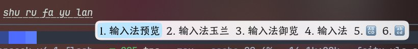

# YLS-Compact · fcitx5 输入法皮肤

本仓库 Fork 自 [SkyShadowHero/deepinlike-fcitx5-theme](https://github.com/SkyShadowHero/deepinlike-fcitx5-theme)，
并在其暗色模式版本的基础上，调整了候选词的内边距，让候选框更贴合文字、整体更紧凑。

## 预览



> 图为浅色主题 `YLS-Compact-light` 的实际效果：候选词高亮框紧贴文字，间距比原版更紧凑。

## 包含两套主题

| 目录 | 说明 |
| --- | --- |
| `YLS-Compact-light` | 浅色主题（见上方预览图） |
| `YLS-Compact-dark` | 暗色主题（深色配色，内边距与浅色版一致） |

## 与原版的区别

只改动了内边距，配色与图形资源（`panel.svg` / `highlight.svg`）与原版完全一致：

| 配置项 | 原版 | 本版 | 效果 |
| --- | --- | --- | --- |
| `TextMargin` 左 / 右 | 12 | **6** | 候选词左右更紧凑 |
| `TextMargin` 上 / 下 | 6 | **3** | 候选词上下更紧凑 |
| `Highlight/Margin` 左 / 右 | 16 | **8** | 高亮框更贴合文字 |
| `Highlight/Margin` 上 / 下 | 9 | **5** | 高亮框更贴合文字 |

如果你更喜欢原版宽松的间距，直接用上游仓库即可。

## 安装

```bash
git clone https://github.com/Lucas2011wastaken/fcitx-yls-skin.git
mkdir -p ~/.local/share/fcitx5/themes

# 浅色主题
cp -r fcitx-yls-skin/YLS-Compact-light ~/.local/share/fcitx5/themes/

# 暗色主题（可选）
cp -r fcitx-yls-skin/YLS-Compact-dark ~/.local/share/fcitx5/themes/
```

> 注意：主题目录必须直接位于 `~/.local/share/fcitx5/themes/` 下，
> 例如 `~/.local/share/fcitx5/themes/YLS-Compact-light/theme.conf`。

## 启用主题

**方式一：图形界面**

运行 `fcitx5-configtool` → 「附加组件」(Addons) → Classic UI → 选择主题。

**方式二：直接改配置**

编辑 `~/.config/fcitx5/conf/classicui.conf`：

```ini
Theme=YLS-Compact-light
DarkTheme=YLS-Compact-dark
```

然后重启 fcitx5：

```bash
fcitx5 -r -d
```

若未生效，可尝试注销重新登录。

## 声明

本项目基于遵循 [Mozilla Public License 2.0](https://www.mozilla.org/en-US/MPL/2.0/) 的
[SkyShadowHero/deepinlike-fcitx5-theme](https://github.com/SkyShadowHero/deepinlike-fcitx5-theme) 修改，
而后者又基于同样遵循 MPL-2.0 的 [Reverier-Xu/Ori-fcitx5](https://github.com/Reverier-Xu/Ori-fcitx5)。

本项目同样依 **MPL-2.0** 协议发布，详见 [LICENSE](LICENSE)。

原始作者：SkyShadowHero · 紧凑间距修改：Lucas2011wastaken
